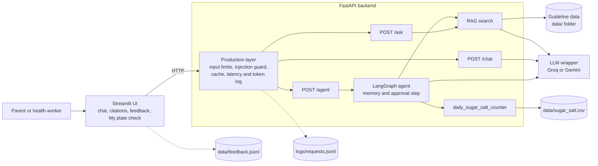

# 🥗 PoshanGuide

**A nutrition assistant for Indian families that answers from official guidelines, shows its sources, and says "I don't know" when it should.**

> ▶️ **Demo video:** [PASTE YOUR VIDEO LINK HERE](PASTE_YOUR_VIDEO_LINK_HERE)

---

## The problem

Families in India get nutrition advice from WhatsApp forwards, neighbours and random websites. Advice about a toddler's iron, a pregnant woman's diet or "how much sugar is too much" is often wrong, and the guidelines that are right (NIN, ICMR) are long PDFs that few people read.

Generic chatbots make this worse: they sound confident, invent facts, never say where an answer came from and have no idea what a typical Indian plate looks like.

## What PoshanGuide does

| Feature | What the user gets |
|---|---|
| **Guideline-grounded answers** | Questions are answered from nutrition guideline documents (RAG), with **citations** under every answer |
| **Honest confidence** | Every `/chat` answer carries `confidence` (high / medium / low) and a useful `follow_up` question. Things it cannot know (for example "which nutritionist is free near my village?") get an honest refusal |
| **Agent with tools** | A LangGraph agent with memory can search the guidelines and run a **daily sugar and salt counter** that totals what you ate against the 20-25 g sugar and salt limits. The counter runs only after the user **approves** it |
| **My plate check** | The user lists what they ate today and sees a colour bar per food group against the NIN "My Plate for the Day" proportions |
| **Feedback loop** | 👍 / 👎 on every answer, saved for later analysis |
| **Production layer** | Latency and token logging, response cache, input limits and a prompt-injection guard (see [Production notes](#production-notes)) |

## Architecture



**Request flow:** the UI sends a question → the production layer checks size, blocks injection attempts and looks in the cache → on a miss, the endpoint runs (`/ask` and `/chat` call the LLM, `/agent` runs the LangGraph loop that chooses between RAG search and the sugar/salt counter) → the answer, citations and confidence come back → latency and tokens are logged.

## Results

> Replace every `___` with your own numbers before you submit. Sources are in the last column.

| Measure | Result | Where it comes from |
|---|---|---|
| Evaluation questions | ___ | your eval set in `eval/` |
| Answers judged correct / grounded | ___ % | `python eval/run_eval.py` output |
| Answers that carry a citation | ___ % | `python eval/run_eval.py` output |
| Out-of-scope questions correctly refused | ___ / ___ | `eval/run_eval.py` |
| Prompt version used (v1 or v2) and why | ___ | `eval/prompt_compare.md` |
| Median latency (uncached) | ___ ms | `python eval/bench_day13.py` |
| p95 latency (uncached) | ___ ms | `python eval/bench_day13.py` |
| Latency on a cache hit | ___ ms | `python eval/bench_day13.py` |
| Average tokens per request | ___ | `python eval/bench_day13.py` |
| Prompt-injection attempts blocked | ___ / ___ | `pytest test/test_day13.py` and bench |

## Production notes

All of this lives in one file, `app/production.py`, attached as a middleware, so the endpoints themselves did not change.

| Concern | What I did | Setting | Measured number |
|---|---|---|---|
| **Latency** | Every request is timed and written as one JSON line to `logs/requests.jsonl` | n/a | p50 ___ ms, p95 ___ ms |
| **Tokens** | Prompt and completion tokens are logged per request (real provider numbers from `llm.py`; estimated at about 4 characters per token when the provider does not report them) | n/a | ___ tokens per request on average |
| **Cache** | In-memory TTL cache for `/ask` and `/chat`. Questions are normalised (case and spacing) before lookup. `/agent` is deliberately not cached because it has memory and an approval step | 600 s TTL, 200 entries | cache hit ___ ms vs ___ ms uncached (___x faster); hit rate ___ % |
| **Input limits** | Question longer than 500 characters gets HTTP 422; request body larger than 10 000 bytes gets HTTP 413. Both are rejected before any LLM call, so they cost no tokens | `MAX_QUESTION_CHARS=500`, `MAX_BODY_BYTES=10000` | 0 tokens spent on rejected requests |
| **Prompt injection** | A pattern guard blocks requests such as "ignore all previous instructions" or "reveal your system prompt" with HTTP 400 before the model sees them. The system prompt also instructs the model never to reveal its instructions (see `prompts/system.md`) | 13 patterns | ___ of ___ test attempts blocked |
| **Monitoring** | `GET /metrics` returns request counts, p50 / p95 latency, cache hit rate and token totals | n/a | n/a |

**Known limits (being honest):**
- The injection guard is a first line of defence. It catches common phrasings, not every clever rewrite. A production system would add a classifier and output filtering.
- The cache is per process and lost on restart. A multi-server deployment would use Redis.
- Token numbers are exact only for providers that report usage; otherwise they are estimates, and the log says which.

## Tech stack

Python · FastAPI · Groq / Gemini (switchable with one env variable) · RAG over guideline documents · LangGraph · Streamlit · pytest · Docker Compose files

## Quick start

```powershell
# 1. install
pip install -r requirements.txt

# 2. add your key (never commit .env)
Copy-Item .env.example .env
code .env

# 3. start the API (terminal 1, repo root)
uvicorn app.main:app --reload

# 4. start the UI (terminal 2, repo root)
streamlit run ui/app.py
```

API docs: http://127.0.0.1:8000/docs · UI: http://localhost:8501 · Metrics: http://127.0.0.1:8000/metrics

Run the tests: `pytest test/test_day13.py -v`

## API

| Endpoint | Purpose |
|---|---|
| `POST /chat` | LLM answer as JSON: `answer`, `confidence`, `follow_up` |
| `POST /ask` (or `GET /ask?question=`) | Guideline-grounded answer with citations |
| `POST /agent` | LangGraph agent. May return `awaiting_approval`; continue with `{"thread_id": "...", "approve": true}` |
| `GET /metrics` | Latency, token and cache summary |
| `GET /health` | Health check |

## Repository layout

```
.
├── app/            FastAPI backend: main, llm, chat, agent, graph, tools, agent_loop, production
├── ui/             Streamlit UI: app.py, plate.py, feedback.py
├── data/           guideline data, plate_reference.json, foods.json, sugar_salt.csv
├── prompts/        system.md, task_v1.md, task_v2.md
├── eval/           prompt comparison, run_eval.py, bench_day13.py, summarize_logs.py
├── test/           test_day13.py
├── docs/           checkpoint-2.md, screenshots/, resume.md, day13_README.md
├── logs/           requests.jsonl (created at runtime, not committed)
├── day01 … day08/  daily task folders
└── README.md
```

Day-by-day notes: Day 06 notes are in `docs/day06_README.md`; Day 13 details are in `docs/day13_README.md`.

## Safety

PoshanGuide gives general nutrition guidance only. It does not diagnose, prescribe or give medicine doses, and it tells the user to see a doctor or health worker for medical problems.
