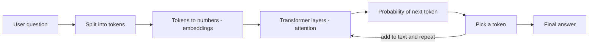

# How LLMs Work (in my own words)

## 1. The one-line idea
A Large Language Model (LLM) is a program that has read a huge amount of text and learned to **guess the next piece of text** really well. Everything it does (answering, summarising, translating) is that one trick repeated many times.

## 2. Step by step

1. **Tokens** – My sentence is cut into small pieces called tokens (words or parts of words). "Poshan" might become `Pos` + `han`.
2. **Numbers (embeddings)** – Each token is turned into a list of numbers. Tokens with similar meaning get similar numbers (e.g. *iron* and *haemoglobin* sit close together).
3. **Attention** – Inside the model (a *transformer*), every token looks at all the other tokens and decides which ones matter most for meaning. In "Give iron-rich food to *her*", attention helps connect "her" to the right person.
4. **Prediction** – The model gives a probability to every possible next token and picks one.
5. **Loop** – The chosen token is added to the text and the process repeats until the answer is finished.

## 3. Diagram

## 4. Training vs. using the model
- **Training:** the model reads massive text, guesses the next token, is told how wrong it was, and adjusts its internal numbers (weights). This is slow and expensive.
- **Inference:** the weights are frozen; it only predicts. This is what happens when someone uses PoshanGuide.

## 5. Why this matters for PoshanGuide
- An LLM does **not look facts up**; it predicts likely text. So it can sound confident and be wrong (**hallucination**). For nutrition advice this is risky.
- It only knows what was in its training data and what I put in the prompt. It does not know today's local info or a specific person's health records.
- So PoshanGuide should answer from **our own data** (retrieval), and say "I don't know" when the data has no answer.

## 6. 10 Real PoshanGuide User Questions

> **[EDIT]** Q1–Q6 must be the 6 questions from *your card*. Replace the samples below. Keep Q6 as a question your data cannot answer.

| # | Question | Can our data answer? | Note |
|---|----------|----------------------|------|
| 1 | [EDIT] What should a pregnant woman eat in the second trimester? | Yes | Covered in nutrition guidelines |
| 2 | [EDIT] Which foods are rich in iron for a 2-year-old? | Yes | Food + age-group data |
| 3 | [EDIT] How much protein does a 10-year-old need daily? | Yes | RDA table |
| 4 | [EDIT] What is a good weaning food at 6 months? | Yes | Infant feeding section |
| 5 | [EDIT] Is jaggery better than sugar for anaemia? | Partly | Iron content only |
| 6 | **[EDIT] Which nutritionist near my village is free this week?** | **No** | **Data has no live local/provider info. The system must say it can't answer.** |
| 7 | What can I give my child instead of milk if he is lactose intolerant? | Yes | Alternatives list |
| 8 | How many calories are in one roti? | Yes | Food composition data |
| 9 | Which vegetables are cheap and rich in vitamin A? | Partly | Nutrition yes, prices no |
| 10 | What are signs of malnutrition in a toddler? | Yes | Health guidance |

## 7. Takeaways
- LLM = next-token predictor built on tokens, embeddings and attention.
- It is fluent, not automatically truthful.
- Good design: ground answers in our data and handle "cannot answer" cases honestly.
